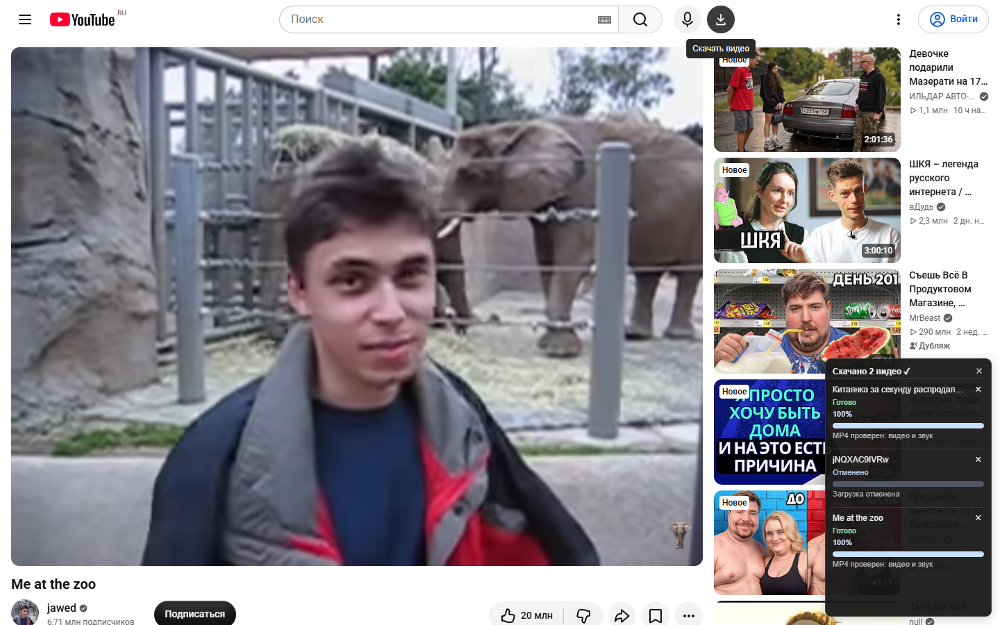

# YouTube Video & Shorts Downloader

Бесплатное личное расширение Chrome для Windows: сохраняйте **обычные видео YouTube и YouTube Shorts** в MP4 со звуком. Выбирайте качество, добавляйте видео в очередь и следите за каждой загрузкой отдельно. Подписка и подключение Google-аккаунта не нужны.

**[Windows ZIP — GitHub Releases](https://github.com/zatylok007-web/youtube-downloader-chrome/releases)** · [Установка](docs/INSTALL_RU.md) · [Обновление](docs/UPDATE_RU.md) · [Помощь](docs/TROUBLESHOOTING_RU.md)

> **Статус 1.1.5: релиз подготовлен как черновик.** Публичный ZIP ещё не выпущен: требуется завершить проверку соответствующих исходников включённых GPL-компонентов. Черновик доступен владельцу репозитория, посетителям архив пока недоступен. [Подробности](docs/THIRD_PARTY_LICENSES.md#статус-публичного-распространения).

## Возможности

- Скачивание обычных видео и Shorts с видео и звуком.
- Выбор качества: максимальное, до 1080p или до 720p.
- Очередь с отдельными полосами прогресса и отменой каждой задачи.
- Перетаскиваемое плавающее окно и компактное меню расширения.
- Завершённые, отменённые и ошибочные строки остаются до ручного скрытия.
- Совместимые дорожки объединяются без перекодирования. Другой вариант качества или перекодирование требуют отдельного выбора.
- Обработка на компьютере: без подписки, извлечения cookies и подключения Google-аккаунта.

Реальный снимок из изолированного профиля Chromium: кнопка обычного видео находится после микрофона; у двух завершённых загрузок свои 100%, отменённая строка сохранена. Изображение не изменялось, аккаунт в профиль не подключался.

## Требования

| Компонент | Требование |
| --- | --- |
| Система | Windows 11, x64 |
| Браузер | Google Chrome 120 или новее, установка распакованного расширения |
| Интернет | Доступ к YouTube и его медиасерверам |
| Установка | Папка текущего пользователя, без прав администратора |

Python, Rust и Node.js устанавливать не нужно: готовый Windows-комплект содержит загрузчик, yt-dlp, Deno/EJS, FFmpeg и FFprobe. Локальный сервер, служба Windows и глобальная настройка PATH не требуются.

Основной браузер — Google Chrome. Изолированные проверки выполнены также в Chromium; отдельная совместимость с Edge и другими браузерами не заявлена. Chrome на Android не поддерживается. Установка через Chrome Web Store не предоставляется.

## Установка

После публикации релиза:

1. Откройте [GitHub Releases](https://github.com/zatylok007-web/youtube-downloader-chrome/releases).
2. В разделе **Assets** скачайте **`YouTubeShortsDownloader-v1.1.5-Windows.zip`** и файл с окончанием `.sha256`. Автоматические архивы **Source code (zip/tar.gz)** содержат документацию репозитория и для установки приложения не подходят.
3. Полностью распакуйте ZIP в постоянную папку пользователя. Не запускайте установку внутри архива и не перемещайте папку после установки.
4. Откройте `chrome://extensions` и включите **«Режим разработчика»**.
5. Нажмите **«Загрузить распакованное расширение»** и выберите папку **`extension`** внутри `YouTubeShortsDownloader`.
6. Запустите **`Setup.cmd`** из этой же папки обычным пользователем.
7. Обновите карточку расширения в Chrome, откройте его меню и проверьте подключение загрузчика. Для проверки файлов и регистрации есть **`Check.cmd`**.
8. Откройте YouTube Shorts или обычное видео и нажмите кнопку со стрелкой.

[Пошаговая инструкция](docs/INSTALL_RU.md) содержит проверку SHA-256 и ожидаемый ID. В Chrome сохраняется прежнее название карточки: **«Загрузка YouTube Shorts»**; обычные видео тоже поддерживаются.

## Использование и настройки

На Shorts кнопка находится справа от верхнего края активного плеера. На обычном видео — справа от микрофона возле поиска в верхней панели YouTube. Если шапка слишком узкая, используйте меню расширения → **«Скачать текущее видео»**.

В меню → **«Настройки и диагностика»** выберите качество и папку загрузки. По умолчанию видео сохраняются в системную папку **«Загрузки → YouTube Shorts»**. Для вертикальных видео предел качества относится к короткой стороне.

Перетаскивайте окно за заголовок. **«Отменить»** останавливает выбранную задачу; маленький **×** скрывает её результат, сохраняя файл и историю. Верхний **×** скрывает окно. Следующее скачивание открывает сохранённый список. Закрытие меню или переход к другому видео не отменяют очередь; после закрытия Chrome незавершённой задаче может потребоваться повторное скачивание.

## Обновление и удаление

Распакуйте следующий релиз **отдельно от установленной папки**, дождитесь конца очереди и временно выключите расширение. Запустите **`Update.cmd` из нового комплекта**, затем включите и обновите прежнюю карточку расширения и страницы YouTube. Скрипт создаёт резервную копию; настройки, история и MP4 сохраняются. Для возврата предыдущих файлов предусмотрен **`Rollback.cmd`**. [Порядок обновления и отката](docs/UPDATE_RU.md).

Для удаления дождитесь окончания загрузок, выключите расширение и запустите **`Uninstall.cmd`** из установленной папки. Затем удалите его карточку в Chrome. Скрипт снимает только собственную регистрацию Native Messaging; видео, настройки, история и резервные копии остаются. [Подробности удаления](docs/INSTALL_RU.md#удаление).

## Если что-то не работает

- **Нет кнопки:** обновите страницу YouTube и проверьте видимость кнопки в настройках. В узком окне используйте меню расширения.
- **Загрузчик отключён:** запустите `Check.cmd`, затем при необходимости `Setup.cmd` из установленной папки и обновите карточку расширения.
- **Нужен выбор качества:** нажмите «Выбрать» в строке задачи. Это ожидание решения, не успешное скачивание.
- **YouTube просит подтвердить, что вы человек:** сайт иногда отказывает анонимным загрузчикам. Подключение Google-аккаунта и извлечение cookies не используются; доступность каждого видео не гарантируется.

[Все способы диагностики](docs/TROUBLESHOOTING_RU.md). Не отключайте антивирус, SmartScreen или защиту браузера ради установки.

## Конфиденциальность

Видео, настройки и история обрабатываются локально. Приложение не содержит телеметрии, рекламы или собственного сервиса сбора данных. Для загрузки оно обращается к YouTube и его медиасерверам; проверка версии yt-dlp обращается к GitHub. Cookies, браузерные профили и пароли не извлекаются. Локальные диагностические файлы могут содержать пути и ID роликов — проверяйте их перед отправкой в Issues.

## Лицензии и обратная связь

Используются [yt-dlp](https://github.com/yt-dlp/yt-dlp), [yt-dlp-ejs](https://github.com/yt-dlp/ejs), [Deno](https://github.com/denoland/deno), [V8](https://v8.dev/) и [FFmpeg](https://ffmpeg.org/). Версии, исходные ссылки, уведомления и незакрытый вопрос распространения описаны в [лицензионной справке](docs/THIRD_PARTY_LICENSES.md). Существующая [лицензия оригинального кода](LICENSE) сохранена без изменения; сторонние компоненты имеют собственные условия. Этот репозиторий содержит публичную документацию, а не полный исходный код приложения.

Об ошибках сообщайте через [GitHub Issues](https://github.com/zatylok007-web/youtube-downloader-chrome/issues): укажите версию, Windows/Chrome, шаги и краткий текст ошибки. Не прикладывайте профили браузера, cookies, токены или неочищенную личную историю.

Проект неофициальный и не связан с YouTube или Google. Названия и товарные знаки принадлежат соответствующим владельцам.
