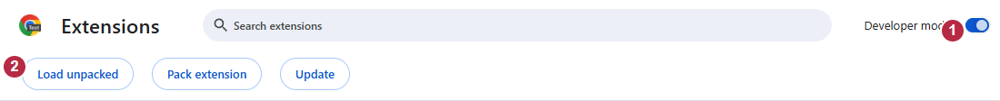
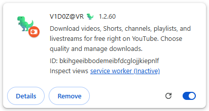
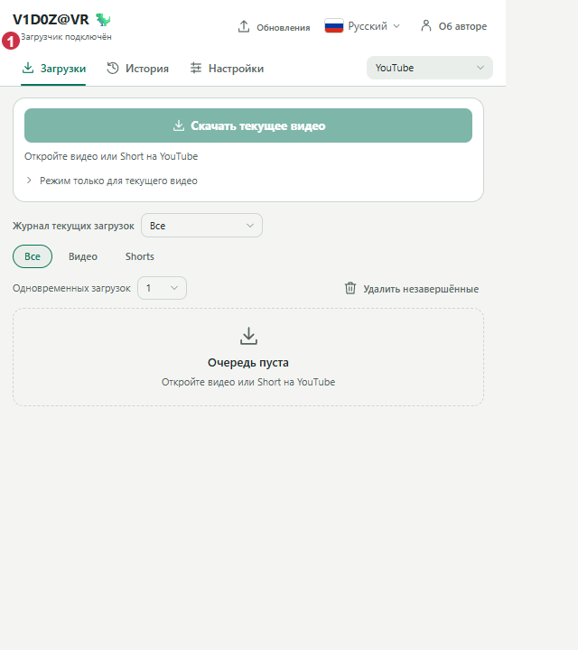

**[Русский](ru.md) | [English (US)](en.md) | [Français](fr.md) | [Deutsch](de.md) | [العربية](ar.md)**

# تثبيت VidoZavr 1.2.60

جميع الوظائف مجانية: تنزيل فيديوهات YouTube وShorts والقنوات وقوائم التشغيل
والبث المباشر، مع أدوات القص وإدارة التنزيلات. تتم معالجة الوسائط على جهازك.
تحتاج إلى **Windows 11 x64 وChrome 127+ واتصال بالإنترنت عند التثبيت لأول مرة**.
لا تحتاج إلى تثبيت Python أو Rust أو Node.js.
يربط مكوّن Windows المتصفح بأدوات التنزيل المحلية عبر Native Messaging؛
**الإضافة وحدها لا تكفي**.

لغات واجهة الإضافة هي: **Русский، English (US)، Français، Deutsch، العربية**.
واجهة مُثبّت Windows باللغة الروسية؛ يوضح هذا الدليل معاني أزراره الأصلية.

## التثبيت الموصى به: تسع خطوات

1. **نزّل [VidoZavr.exe](https://github.com/zatylok/youtube-downloader-chrome/releases/download/v1.2.60/VidoZavr.exe).**
   لا تحتاج إلى تنزيل ملف ZIP أيضًا. استخدم الإصدار الرسمي وقارن
   [قيمة SHA-256](https://github.com/zatylok/youtube-downloader-chrome/releases/download/v1.2.60/SHA256SUMS.txt).
2. **شغّل ملف EXE وثبّت مكوّنات Windows.** واجهة المُثبّت روسية:
   <code dir="ltr">Далее</code> تعني «التالي»، و<code dir="ltr">Готово</code> تعني «إنهاء».
   انتظر رسالة <code dir="ltr">Компоненты Windows установлены</code>، أي «تم تثبيت مكوّنات Windows».
   ينزّل Setup الأدوات الناقصة بالإصدارات المحددة ويتحقق منها، ويعيد استخدام الملفات
   المثبّتة المطابقة. لا يفتح Chrome ولا يختبر اتصالًا مباشرًا بالمتصفح.
3. **اقرأ شاشة Setup الأخيرة قبل إغلاقها.** يعرض حقل المسار مجلد الإضافة الدائم.
   زر <code dir="ltr">Папка расширения</code> يعني «مجلد الإضافة» ويفتحه،
   وزر <code dir="ltr">Инструкция</code> يعني «التعليمات» ويفتح الدليل المثبّت.
   احتفظ بالمسار الدقيق لاستخدامه في الخطوة 7.
4. **افتح <code dir="ltr">chrome://extensions</code>** في ملف Chrome الشخصي الذي تستخدمه مع YouTube.
   اكتب العنوان في شريط العناوين؛ هذه صفحة داخلية في المتصفح وليست موقعًا على الإنترنت.
5. **فعّل «وضع مطوّر البرامج»** أعلى الصفحة.
6. **اضغط «تحميل إضافة تم فك حزمتها».** ستفتح نافذة اختيار مجلد في Windows.
7. **اختر مجلد <code dir="ltr">extension</code> المثبّت نفسه من الخطوة 3.**
   انتقل إليه في نافذة الاختيار، أو الصق مسار Setup الدقيق في حقل المجلد
   (<code dir="ltr">Папка</code> في Windows الروسي)، ثم أكّد الاختيار
   (<code dir="ltr">Выбор папки</code>).
   يجب أن يكون <code dir="ltr">manifest.json</code> داخل المجلد مباشرة.
   اختر المجلد، لا الملف نفسه ولا مجلد «التنزيلات» ولا المجلد الرئيسي للبرنامج ولا ملف ZIP.
8. **تحقق من وجود بطاقة واحدة مفعّلة للإضافة V1D0Z@VR 🦖 بالإصدار <code dir="ltr">1.2.60</code>.**
   يظهر معرّف الإضافة في وضع مطوّر البرامج:
   <code dir="ltr">bkihgeeibbodemeibfdcglojjkiepnlf</code>.
9. **افتح قائمة إضافات Chrome من رمز قطعة الأحجية، ثم اختر V1D0Z@VR.**
   تحقق من ظهور **«مكوّن التنزيل متصل»**؛ يقابله في الواجهة الروسية
   <code dir="ltr">Загрузчик подключён</code>.
   يمكنك تثبيت الأيقونة في شريط الأدوات. ظهور البطاقة وحده لا يؤكد اتصال مكوّن Native.

المجلد الافتراضي، مكتوبًا من اليسار إلى اليمين:

`%LOCALAPPDATA%\Programs\YouTube Video & Shorts Downloader\extension`

**قد يختلف المسار عند اختيار موقع تثبيت مخصص. المسار الكامل الذي يعرضه Setup هو المرجع الصحيح.**
احتفظ بهذا المجلد الدائم واترك وضع مطوّر البرامج مفعّلًا.
إذا أغلقت Setup، يمكنك فتح التعليمات من قائمة «ابدأ»؛ استخدم مجلد التثبيت الذي
اخترته ثم المجلد الفرعي <code dir="ltr">extension</code>.

### التعرّف على الأزرار

الصورة التالية باللغة **الإنجليزية**: الرقم **1** يشير إلى
Developer mode، أي «وضع مطوّر البرامج»، والرقم **2** إلى
Load unpacked، أي «تحميل إضافة تم فك حزمتها».
إنها لقطة حقيقية من Chromium 149 معزول يعمل دون نافذة ظاهرة؛ استُبعدت المساحة الفارغة من اللقطة.

تُظهر البطاقة الحقيقية اسم الإضافة وإصدارها ومعرّفها ومفتاح تفعيلها.

مثال على اتصال مؤكّد — واجهة روسية

الرقم **1** يحدد <code dir="ltr">Загрузчик подключён</code>، أي «مكوّن التنزيل متصل».
تُظهر هذه الصورة المحفوظة استجابة Native حقيقية في بيئة معزولة؛
وليست اختبارًا جديدًا للتثبيت اليدوي.

هذه الصور من ملفات شخصية تجريبية معزولة في **Chromium 149 دون نافذة ظاهرة**،
وليست من Chrome 156 أو تثبيت Windows جديد.
البطاقة للتوضيح، و[الصورة الكاملة الأصلية](images/chrome-extensions.png) ما زالت متاحة.
لم تُختلق صور عربية أو صور لشاشة إنهاء Setup أو نافذة اختيار المجلد.

## خيارات التثبيت الأخرى

- **للمستخدمين المتقدمين — [VidoZavr-Extension.zip](https://github.com/zatylok/youtube-downloader-chrome/releases/download/v1.2.60/VidoZavr-Extension.zip):**
  ثبّت مكوّن Windows باستخدام ملف EXE الموصى به، وفك ضغط ZIP في مجلد دائم مستقل،
  ثم حمّل هذا المجلد **بدلًا من** النسخة المُدارة.
  لا يستطيع Chrome تحميل ملف ZIP نفسه. لا يحدّث Setup ولا نظام التحديثات الموقّعة
  هذه النسخة المستقلة: استبدل ملفاتها بملفات ZIP الرسمي المطابق لكل إصدار، ثم أعد تحميل
  بطاقتها الحالية. لا تحمّل النسختين معًا.
- **Beta/Experimental — [VidoZavr-Experimental.exe](https://github.com/zatylok/youtube-downloader-chrome/releases/download/v1.2.60/VidoZavr-Experimental.exe):**
  يحاول ربط Chrome تلقائيًا باستخدام تثبيت Windows نفسه.
  قد يتطلب تفعيل وضع مطوّر البرامج أو اختيار الملف الشخصي أو اتخاذ قرارات بشأن الأذونات،
  وقد تعيق إضافات أخرى العملية. لا يُضمن النجاح أو التشغيل دون تدخل.
  التحقق على تثبيت Windows نظيف غير مكتمل.
  اقرأ [القيود](EXPERIMENTAL.md).

## الأمان والأدوات التي تُنزّل

ملفات EXE **لا تحمل توقيع Windows Authenticode**.
قد يعرض SmartScreen تحذيرًا عن ناشر غير معروف. تحقق من المصدر الرسمي وقيمة التجزئة،
وألغِ التشغيل عند الشك. لا تعطّل وسائل الحماية لإجبار التثبيت على المتابعة.
للتحقق الاختياري من SHA-256، استخدم الأمر التالي كما هو:

`Get-FileHash .\VidoZavr.exe -Algorithm SHA256`

يجلب Setup مباشرةً من المورّدين المحددين yt-dlp بالإصدار **2026.10.21**،
وDeno بالإصدار **2.9.8**، وFFmpeg/FFprobe بالإصدار **9.0.2**، بتوزيعة Windows من Gyan Doshi.
يتحقق من أحجام الملفات وقيم SHA-256. ملفات EXE الخارجية هذه غير مضمّنة في ملفاتنا المنشورة.
التثبيت لأول مرة ليس متاحًا بالكامل دون اتصال بالإنترنت.
اطّلع على [المكوّنات والمصادر والتراخيص وقيم التجزئة](COMPONENTS.md).
**توقيع Ed25519 لتحديثات التطبيق منفصل عن توقيع مُثبّت Windows.**

## التحديث وإلغاء التثبيت

تحدّث التحديثات الموقّعة مجلد التثبيت، وتنتظر ما دامت هناك مهام وسائط محمية لم تنتهِ.
إذا استمر Chrome في عرض إصدار قديم بعد اكتمال التحديث، اضغط زر **إعادة التحميل**
على البطاقة الحالية في <code dir="ltr">chrome://extensions</code>، ثم حدّث علامات تبويب YouTube.
احتفظ بالبطاقة وتفضيلاتها؛ لا يُضمن التفعيل دون تدخل في جميع إصدارات Chrome.
تحتاج مجلدات ZIP المستقلة إلى تحديث ملفاتها يدويًا.

للإصلاح، أعد تشغيل Setup بعد انتهاء المهام واتبع أي رسالة عن ملفات قيد الاستخدام.
احتفظ بالمهام المتوقفة مؤقتًا والملفات الجزئية.
لإلغاء التثبيت، افتح **إعدادات Windows ← التطبيقات ← V1D0Z@VR ← إلغاء التثبيت**،
ثم أزل بطاقة الإضافة من Chrome.
تبقى ملفات الوسائط و<code dir="ltr">native\data</code> و<code dir="ltr">.updates</code>.
قد تؤدي إزالة البطاقة إلى حذف تفضيلات الإضافة المحفوظة في المتصفح.

## استكشاف المشكلات وحلها

| المشكلة | الإجراء المدعوم |
|---|---|
| ملف البيان مفقود أو تعذّر تحميله | أعد اختيار «تحميل إضافة تم فك حزمتها»، وحدد مجلد <code dir="ltr">extension</code> الذي يحتوي مباشرةً على <code dir="ltr">manifest.json</code>. لا تختر «التنزيلات» أو المجلد الرئيسي أو ZIP. |
| البطاقة موجودة لكن مكوّن التنزيل غير متصل | تحقق من تثبيت مكوّن Windows **لحساب Windows نفسه** ومن استخدام ملف Chrome الشخصي والمجلد الصحيحين. يفحص <code dir="ltr">Check.cmd</code> في مجلد التثبيت الملفات والتسجيل، وتؤكد قائمة الإضافة الاتصال الفعلي. استخدم Setup للإصلاح بعد انتهاء المهام عند الحاجة. |
| وضع مطوّر البرامج غير مفعّل | فعّله في الملف الشخصي المطلوب، واتركه مفعّلًا، وتحقق من تفعيل البطاقة الحالية. |
| ملف شخصي غير صحيح أو نسخ مكررة | حدد الملف الشخصي الذي ثبّتَّ فيه الإضافة والمجلد الدائم المقصود. لا تضف نسخة أخرى لإصلاح الاتصال؛ إزالة البطاقة قد تحذف تفضيلاتها. |
| التحديث اكتمل لكن Chrome يعرض إصدارًا قديمًا | بعد انتهاء المهام المحمية، أعد تحميل **البطاقة الحالية** وحدّث علامات تبويب YouTube. لا تحذف بيانات المهام المتوقفة مؤقتًا. |
| مشكلة شبكة أو مسارات VPN أو فشل تنزيل أداة أو التحقق من التجزئة | تحقق من اتصال مكوّن التنزيل أيضًا، لا Chrome وحده؛ قد يستخدمان مسارين مختلفين مع التوجيه الانتقائي. أعد المحاولة من المصدر الرسمي. لا تستخدم مرايا عشوائية ولا تغيّر قيم التجزئة ولا تعطّل الحماية. |
| تحذير SmartScreen | المُثبّت غير موقّع. تحقق من مصدره وقيمته المرجعية؛ ألغِ التشغيل عند الشك. |
| تعطّل Experimental بسبب إضافة أخرى | لا توافق عشوائيًا على طلبات لا تخص التطبيق، ولا تعطّل إضافات أخرى. أغلق Setup الخاص بك بالطريقة المعتادة، ثم استخدم التثبيت اليدوي الموصى به. |

للمساعدة: [GitHub Issues](https://github.com/zatylok/youtube-downloader-chrome/issues) أو
[@zatylok007](https://t.me/zatylok007).
أرسل الإصدار ونص الخطأ والخطوات المختصرة، ولا ترسل ملفات شخصية خاصة أو ملفات تعريف الارتباط أو الرموز السرية.
[الأذونات والخصوصية](../../README.md#windows-warnings-permissions-and-privacy) |
[الخيارات واللغات](README.md)

