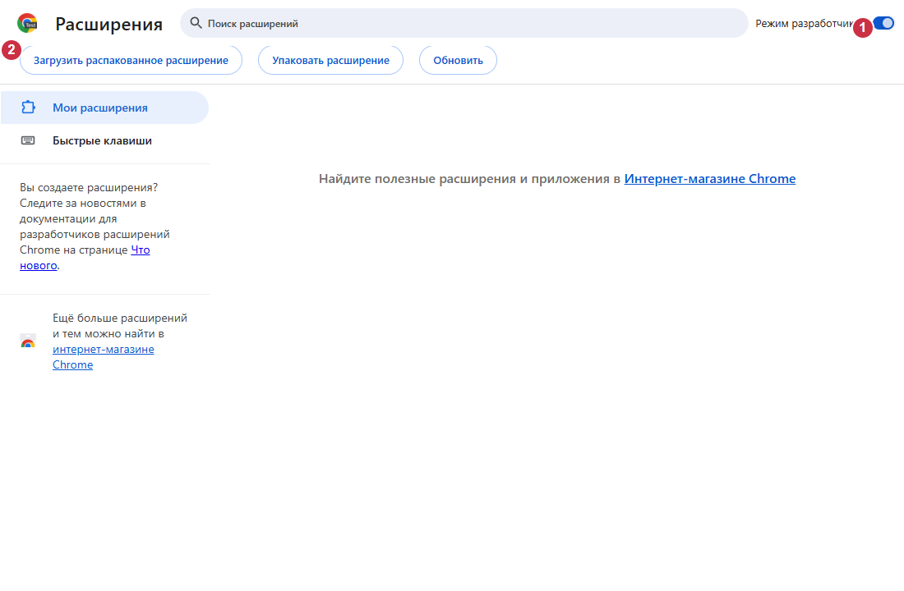

# VidoZavr 1.2.60 installieren

[Varianten und Sprachen](README.md) · [Komponenten](COMPONENTS.md)

## Zweck und Voraussetzungen

V1D0Z@VR lädt kostenlos YouTube-Videos, Shorts, Kanäle, Playlists und Livestreams
herunter, mit Werkzeugen zum Zuschneiden und Verwalten der Aufgaben.
Die Medienverarbeitung erfolgt lokal. Der Windows-Host verbindet Chrome über Native
Messaging mit yt-dlp, Deno und FFmpeg; die Erweiterung allein reicht nicht aus.
Benötigt werden Windows 11 x64, Chrome und Internet bei der Erstinstallation.
Python, Rust und Node.js müssen Benutzer nicht installieren.

## Herunterladen und prüfen

Verwenden Sie die [offiziellen Releases](https://github.com/zatylok/youtube-downloader-chrome/releases).
Wählen Sie die Dateien der Version 1.2.60 aus demselben offiziellen Release.
Laden Sie **VidoZavr.exe** und die `.sha256`-Datei herunter. Die Erweiterungs-ZIP ist
optional. SHA-256 mit `SHA256SUMS.txt` desselben Releases vergleichen, etwa mit
`Get-FileHash .\VidoZavr.exe -Algorithm SHA256`. Der Befehl liest nur die Datei;
zur Installation sind keine Befehle oder Registry-Eingriffe nötig.

Die EXE besitzt **keine Windows-Authenticode-Signatur**. SmartScreen kann einen
unbekannten Herausgeber melden. Quelle und Hash prüfen, im Zweifel abbrechen.
Schutzfunktionen nicht deaktivieren. Ed25519 für Programmupdates ist davon getrennt.

## Windows-Komponenten installieren

Der Installer ist russisch: **Далее = Weiter**, **Готово = Fertigstellen**.
Die empfohlene EXE starten und auf „Компоненты Windows установлены“ (Windows-Komponenten
installiert) warten. Fehlende festgelegte Werkzeuge werden bezogen und geprüft;
vorhandene geprüfte Versionen werden wiederverwendet. Chrome wird nicht geöffnet.
Eine aktive Browserverbindung wird nicht als geprüft ausgegeben. Die letzte Seite
zeigt den genauen Ordner. **Инструкция** öffnet die Anleitung, **Папка расширения**
den Ordner; beide Aktionen benötigen einen ausdrücklichen Klick.

## Chrome manuell verbinden

1. Im gewünschten Profil `chrome://extensions` öffnen.
2. **Entwicklermodus** einschalten.
3. **Entpackte Erweiterung laden** wählen.
4. Den vom Installer angezeigten Ordner `extension` auswählen. Standard:
   `%LOCALAPPDATA%\Programs\YouTube Video & Shorts Downloader\extension`.
   `manifest.json` muss unmittelbar darin liegen.
5. Eine V1D0Z@VR-Karte mit ID `bkihgeeibbodemeibfdcglojjkiepnlf` prüfen.
6. Im Menü **Downloader verbunden** oder den gleichbedeutenden Status der gewählten Sprache prüfen.

Den Entwicklermodus eingeschaltet lassen. Berechtigungen selbst lesen und entscheiden;
der Installer umgeht keine Chrome-Sicherheitsabfrage.

## ZIP und Experimental

Die EXE installiert bereits die verwaltete Erweiterung; eine zweite Kopie ist unnötig.
Für eine unabhängige Kopie die ZIP in einen dauerhaften Ordner entpacken und diesen
stattdessen laden. Chrome kann die ZIP nicht direkt laden. Die Windows-Komponente
bleibt nötig. Nicht beide Kopien laden. Unabhängige Dateien mit der passenden
offiziellen ZIP manuell aktualisieren und die bestehende Karte neu laden.

Die [Beta/Experimental-Variante](EXPERIMENTAL.md) behält die automatische Einbindung.
Entwicklermodus, Berechtigungsentscheidungen oder manuelle Wiederherstellung können
erforderlich sein. Andere Erweiterungen oder die Profilauswahl können sie blockieren.
Sie ist weder garantiert noch vollständig unbeaufsichtigt; ein sauberes Windows ist
nicht vollständig geprüft. Beide Installer verwenden dieselbe Installation.

## Aktualisieren und deinstallieren

Signierte Programmupdates pflegen den installierten Ordner und warten auf das Ende
geschützter Arbeit. Zeigt Chrome noch die alte Version, die bestehende Karte unter
`chrome://extensions` neu laden und YouTube-Tabs aktualisieren. Eine nahtlose Aktivierung
in jeder Chrome-Version wird nicht zugesichert. Die Karte für Updates nicht entfernen.
Zur Reparatur Setup nach Arbeitsende erneut starten. Bei belegten Dateien die Erweiterung
bei entsprechender Meldung vorübergehend deaktivieren. Pausierte Aufgaben und Teildateien
behalten. Über Windows-Einstellungen → Apps → V1D0Z@VR deinstallieren, danach die
Chrome-Karte entfernen. Videos, `native\data` und `.updates` bleiben erhalten.

## Fehlerbehebung

- Keine Verbindung: denselben Windows-Benutzer, Windows-Komponenten und den richtigen
  Ordner prüfen; nach Arbeitsende reparieren und Chrome neu starten.
- Manifest fehlt: entpackten Ordner statt ZIP oder übergeordnetem Ordner auswählen.
- Netzwerk-/Hashfehler: offizielle Quelle erneut versuchen, Prüfsummen nicht umgehen.
  Chrome und Downloader können unterschiedliche VPN-Routen verwenden.
- Eine Offline-Erstinstallation erhält keine fehlenden Werkzeuge. Reparaturen können
  geprüfte vorhandene Dateien nutzen; vollständiger Offlinebetrieb wird nicht versprochen.
- `Check.cmd` prüft Dateien und Registrierung; den Live-Status im Erweiterungsmenü prüfen.

## Abbildungen

Echter isolierter Headless-Chromium 149 mit russischer Oberfläche und ergänzten
Nummern: **1** Entwicklermodus, **2** entpackte Erweiterung laden. Das leere Testprofil
belegt keine manuelle Einbindung oder Installation auf einem sauberen Windows.

Im echten Erweiterungsmenü wurde eine gültige Native-Antwort empfangen.
**1** markiert den verbundenen Downloader. Keine persönlichen Konten oder Besitzerprofile.

[README](../../README.md): Berechtigungen und Netzwerk. [Komponentenübersicht](COMPONENTS.md): Quellen und Lizenzen.
