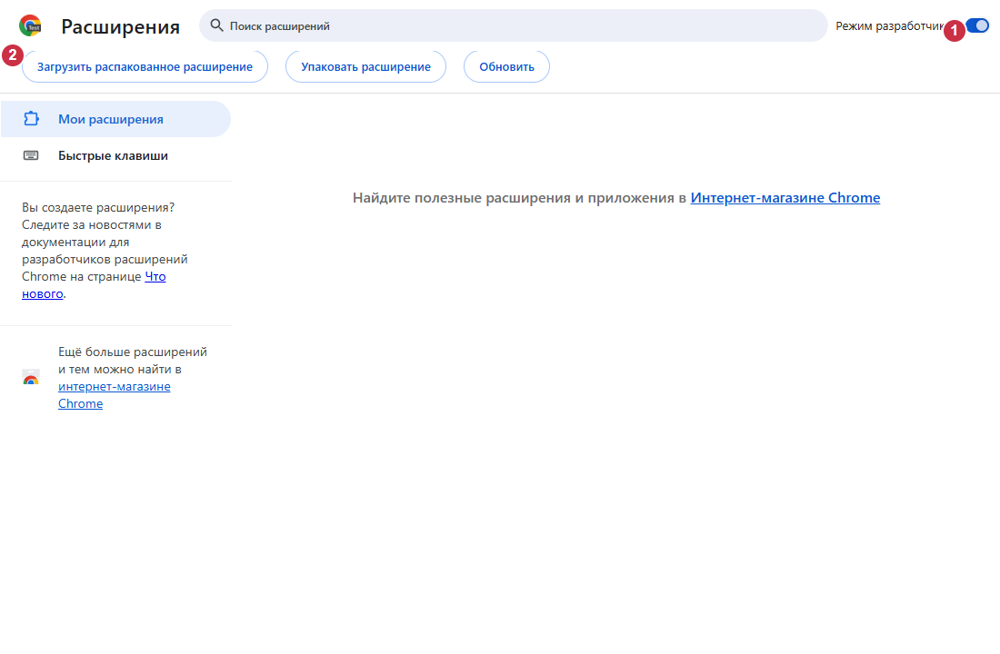

# Install VidoZavr 1.2.60

[Options and languages](README.md) · [Components](COMPONENTS.md)

## Purpose and requirements

V1D0Z@VR is a free YouTube downloader for videos, Shorts, channels, playlists and
LIVE, with cropping and queue tools. Media processing runs locally. The Windows
Native Messaging host connects Chrome to yt-dlp, Deno and FFmpeg; the extension
alone cannot run those tools. Use Windows 11 x64, Chrome and Internet access for
first installation. Python, Rust and Node.js are not required for users.

## Download and verify

Use [official releases](https://github.com/zatylok/youtube-downloader-chrome/releases).
Choose the 1.2.60 files from the same official release.
Download **VidoZavr.exe** and its `.sha256` file. The extension ZIP is optional.
Compare SHA-256 with `SHA256SUMS.txt` from the same release, for example with
`Get-FileHash .\VidoZavr.exe -Algorithm SHA256`. This only reads the file;
installation requires no commands or manual registry editing.

The EXE is **not Windows Authenticode-signed**. SmartScreen may report an unknown
publisher. Check the source and hash; cancel if uncertain. Do not disable security
controls. Ed25519 signing of application updates is a separate protection.

## Install Windows components

The installer uses Russian labels: **Далее = Next**, **Готово = Finish**.
Run the recommended EXE, click Next and wait for “Компоненты Windows установлены”
(Windows components installed). Setup obtains missing pinned tools, verifies their
hashes and registers Native Messaging. Verified existing tools are reused.
It does not open Chrome or claim a live browser connection. The final page shows
the exact extension folder. **Инструкция** opens instructions; **Папка расширения**
opens that folder. Both require your explicit click.

## Connect Chrome manually

1. In the intended Chrome profile, open `chrome://extensions`.
2. Turn on **Developer mode**.
3. Click **Load unpacked**.
4. Select the installed `extension` folder shown by Setup. Default:
   `%LOCALAPPDATA%\Programs\YouTube Video & Shorts Downloader\extension`.
   `manifest.json` must be directly inside the selected folder.
5. Check one V1D0Z@VR card, ID `bkihgeeibbodemeibfdcglojjkiepnlf`.
6. Open its popup and confirm **Downloader connected**, or the equivalent in its selected language.

Leave Developer mode enabled. Read and decide Chrome permission requests yourself.
Setup does not bypass browser security.

## Advanced ZIP and Experimental options

The EXE already installs the managed extension: do not extract a duplicate unnecessarily.
For an independent copy, extract the ZIP into a permanent folder and load that folder
instead. Chrome cannot load a ZIP directly. The Windows component remains required.
Setup does not update an independent folder; replace its files manually with the
matching official ZIP, then reload the existing extension card.

The [Beta/Experimental installer](EXPERIMENTAL.md) retains automatic enrollment.
It may require Developer mode, permission decisions or manual recovery. It can be
blocked by other extensions or profile selection. It is not guaranteed or fully unattended;
clean-Windows verification is incomplete. It uses the same installation, not a second app.

## Updates and uninstall

Signed application updates maintain the installed folder and defer while protected
work remains. If Chrome still shows an old version, reload its existing card in
`chrome://extensions` and refresh YouTube tabs. Seamless activation on every Chrome
build is not guaranteed. Do not remove the card for ordinary updates.
Run Setup again for repair after downloads finish. Busy-file protection may require
temporarily disabling the extension. Preserve paused work and partial files.
Uninstall through Windows Settings → Apps → V1D0Z@VR, then remove its Chrome card.
Media, `native\data` and `.updates` are retained.

## Troubleshooting

- Disconnected: check the same Windows user, installed Windows components and exact
  folder; repair after work finishes, then restart Chrome.
- Missing manifest: select the unpacked folder, not its parent or the ZIP.
- Network/hash failure: retry the official source; never replace expected hashes.
  Chrome and the downloader may use different effective VPN routes.
- A clean offline installation cannot obtain missing tools. Repair can reuse verified
  installed tools; fully offline operation is not promised.
- `Check.cmd` checks files and registration; the popup verifies the live connection.

## Illustrated controls

Real isolated headless Chromium 149, Russian UI, with numbered guide overlays:
**1** Developer mode, **2** Load unpacked. This empty test profile is not a recording
of manual enrollment or a clean-Windows installation.

The real extension popup below received a valid Native response. **1** marks
“Downloader connected”; no personal account or owner profile was used.

See the [README](../../README.md) for permissions and network scope, and the
[component audit](COMPONENTS.md) for sources and attribution.
