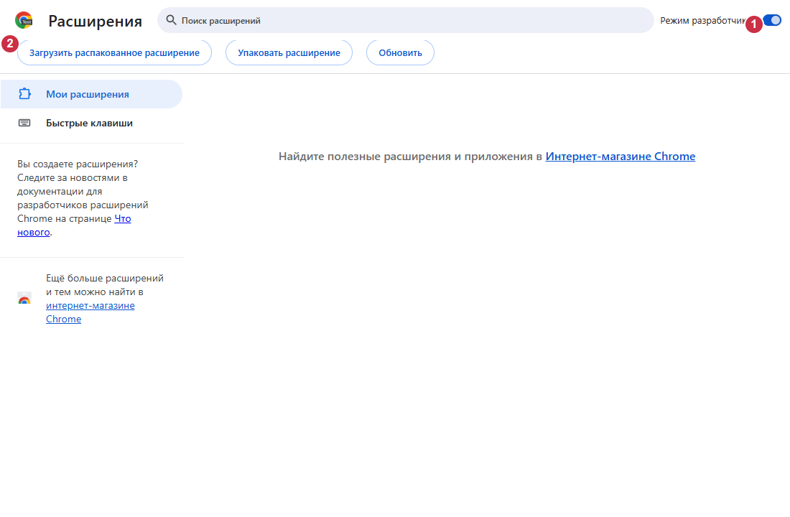

# Instalar o VidoZavr 1.2.60

[Opções e idiomas](README.md) · [Componentes](COMPONENTS.md)

## Finalidade e requisitos

O V1D0Z@VR baixa gratuitamente vídeos do YouTube, Shorts, canais, playlists e
transmissões ao vivo, com recorte e gerenciamento das tarefas. O processamento
de mídia é local. O componente do Windows conecta o Chrome ao yt-dlp, Deno e FFmpeg
por Native Messaging; a extensão sozinha não basta. É necessário Windows 11 x64,
Chrome e Internet na primeira instalação. Python, Rust e Node.js não são necessários.

## Baixar e conferir

Use as [versões oficiais](https://github.com/zatylok/youtube-downloader-chrome/releases).
Escolha os arquivos 1.2.60 da mesma versão oficial.
Baixe **VidoZavr.exe** e seu `.sha256`. O ZIP da extensão é opcional.
Compare o SHA-256 com `SHA256SUMS.txt` da mesma versão, por exemplo com
`Get-FileHash .\VidoZavr.exe -Algorithm SHA256`. Esse comando apenas lê o arquivo;
a instalação não exige comandos nem alterações manuais no Registro.

O EXE **não tem assinatura Windows Authenticode**. O SmartScreen pode informar
um fornecedor desconhecido. Confira origem e hash; cancele se houver dúvida.
Não desative as proteções. A assinatura Ed25519 das atualizações é uma proteção separada.

## Instalar no Windows

O instalador está em russo: **Далее significa Avançar**, **Готово, Concluir**.
Execute o EXE recomendado e aguarde «Компоненты Windows установлены» (componentes
do Windows instalados). O Setup obtém e verifica as ferramentas fixadas que faltam;
reutiliza as versões existentes verificadas. Não abre o Chrome nem afirma ter
confirmado uma conexão ativa. A última tela mostra o caminho exato.
**Инструкция** abre as instruções; **Папка расширения** abre essa pasta.
As duas ações só acontecem quando você clica no botão correspondente.

## Conectar o Chrome manualmente

1. No perfil desejado, abra `chrome://extensions`.
2. Ative o **Modo do desenvolvedor**.
3. Clique em **Carregar sem compactação**.
4. Selecione a pasta `extension` indicada pelo Setup. Caminho padrão:
   `%LOCALAPPDATA%\Programs\YouTube Video & Shorts Downloader\extension`.
   O arquivo `manifest.json` deve estar diretamente nessa pasta.
5. Confira uma única V1D0Z@VR, ID `bkihgeeibbodemeibfdcglojjkiepnlf`.
6. Abra o menu e confira **Downloader connected** (componente de download conectado)
   ou a mensagem equivalente no idioma configurado na extensão.

Mantenha o modo do desenvolvedor ativado. Leia e decida as solicitações de permissão;
o Setup não contorna a segurança do Chrome.

## ZIP e Experimental

O EXE já instala a cópia gerenciada: não é preciso extrair outra.
Para uma cópia independente, extraia o ZIP para uma pasta permanente e selecione-a
em vez da instalada. O Chrome não carrega o ZIP diretamente. O componente Windows
continua obrigatório. Não carregue as duas cópias. Atualize uma pasta independente
substituindo os arquivos pelo ZIP oficial correspondente e recarregando a extensão existente.

A variante [Beta/Experimental](EXPERIMENTAL.md) mantém a conexão automática.
Pode exigir modo do desenvolvedor, decisões sobre permissões ou recuperação manual.
Outras extensões ou a seleção de perfis podem bloqueá-la. Não há garantia de sucesso
ou operação totalmente automática; a verificação em Windows limpo está incompleta.
Os dois instaladores usam a mesma instalação, não dois aplicativos diferentes.

## Atualizar e desinstalar

As atualizações assinadas mantêm a pasta instalada e aguardam o fim do trabalho
protegido. Se o Chrome mostrar a versão antiga, recarregue a extensão existente em
`chrome://extensions` e atualize as abas do YouTube. Não se garante ativação automática
em todas as versões do Chrome. Não remova a extensão para uma atualização comum.
Para reparar, execute o Setup depois de terminar as transferências. Se a proteção
indicar arquivos em uso, desative temporariamente a extensão quando solicitado.
Preserve tarefas pausadas e arquivos parciais. Desinstale em Configurações do Windows
→ Aplicativos → V1D0Z@VR; depois remova a extensão do Chrome. Vídeos, `native\data`
e `.updates` são preservados.

## Problemas comuns

- Sem conexão: confira o usuário Windows, o componente instalado e a pasta correta;
  repare após terminar o trabalho e reinicie o Chrome.
- Manifesto ausente: selecione a pasta extraída, não o ZIP nem a pasta acima dela.
- Rede/hash: tente a fonte oficial novamente, sem alterar os hashes esperados.
  O Chrome e o processo de download podem usar rotas VPN diferentes.
- Sem Internet, uma instalação nova não obtém ferramentas ausentes. Uma reparação
  pode reutilizar arquivos verificados; não há promessa de operação totalmente offline.
- `Check.cmd` verifica arquivos e registro; a conexão ativa é confirmada no menu.

## Ilustrações

Chromium 149 real, isolado e sem janela visível, com interface russa e números
adicionados: **1** modo do desenvolvedor, **2** carregar sem compactação. Esse perfil
vazio não comprova uma instalação manual nem uma verificação em Windows limpo.

O menu real da extensão recebeu uma resposta Native válida.
**1** indica o componente conectado. Nenhuma conta ou perfil pessoal foi usado.

[README](../../README.md): permissões e rede. [Auditoria](COMPONENTS.md): fontes e licenças.
