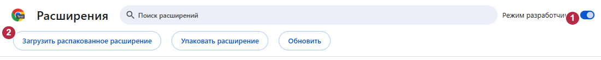
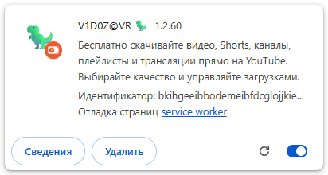

# Установка VidoZavr 1.2.70

**[Русский](ru.md) | [English (US)](en.md) | [Français](fr.md) | [Deutsch](de.md) | [العربية](ar.md)**

Все функции бесплатны: видео YouTube, Shorts, каналы, плейлисты, трансляции, обрезка
и управление загрузками. Обработка выполняется на вашем ПК. Нужны **Windows 11 x64,
Chrome 127+ и интернет при первой установке**. Python, Rust и Node.js не нужны.
Windows-компонент связывает Chrome с локальным загрузчиком через Native Messaging.
**Одного расширения недостаточно.**

В версии 1.2.70 единый редактор видео и Shorts сохраняет черновики и поддерживает до восьми масок со своими интервалами. «Удаление ✨» использует локальную интерполяцию FFmpeg для неподвижной прямоугольной области без поворота на 8-битном SDR. На сложном фоне могут остаться следы. Тест прокси проверяет связь, но YouTube может отказать в выдаче метаданных с кодом `bot_check`. При необходимости выберите «Напрямую» вручную.

## Рекомендуемая установка: девять шагов

1. **Скачайте [VidoZavr.exe](https://github.com/zatylok/youtube-downloader-chrome/releases/download/v1.2.70/VidoZavr.exe).**
   Дополнительный ZIP не нужен. Используйте официальный релиз и сравните
   [SHA-256](https://github.com/zatylok/youtube-downloader-chrome/releases/download/v1.2.70/SHA256SUMS.txt).
2. **Запустите EXE и установите компоненты Windows.** Нажмите **Далее** и дождитесь
   экрана **Компоненты Windows установлены**. Недостающие закреплённые инструменты
   скачиваются и проверяются; проверенные установленные файлы используются повторно.
   Setup не открывает Chrome и не проверяет живую связь с браузером.
3. **Прочитайте последний экран до нажатия «Готово».** В поле указан точный постоянный
   путь расширения. **Папка расширения** открывает эту папку, **Инструкция** - установленную
   инструкцию. Сохраните точный путь для шага 7.
4. **Откройте `chrome://extensions`** в том профиле Chrome, где смотрите YouTube.
   Введите адрес в адресную строку: это внутренняя страница Chrome, а не сайт.
5. **Включите «Режим разработчика»** справа вверху.
6. **Нажмите «Загрузить распакованное расширение».** Откроется окно выбора папки Windows.
7. **Выберите именно установленную папку `extension` из шага 3.**
   Перейдите в неё в окне выбора или вставьте точный путь из Setup в поле **Папка**
   и нажмите **Выбор папки**. Внутри выбранной папки должен лежать `manifest.json`.
   Выбирайте папку, а не сам файл: «Загрузки», родительская папка программы и ZIP
   не подходят.
8. **Проверьте одну включённую карточку V1D0Z@VR 🦖**, версия **1.2.70**.
   В режиме разработчика виден ID `bkihgeeibbodemeibfdcglojjkiepnlf`.
9. **Откройте меню расширений Chrome со значком пазла → V1D0Z@VR.**
   Должен появиться статус **Загрузчик подключён**. При желании закрепите значок.
   Одна карточка ещё не подтверждает связь с Windows-загрузчиком.

Папка по умолчанию:

`%LOCALAPPDATA%\Programs\YouTube Video & Shorts Downloader\extension`

**При установке в другое место путь отличается. Точный путь на последнем экране Setup -
главный ориентир.** Не удаляйте эту постоянную папку и оставьте режим разработчика
включённым. Если Setup уже закрыт, инструкция доступна через меню «Пуск»; используйте
выбранную при установке папку программы и её подпапку `extension`.

### Как выглядят нужные элементы

**1** - режим разработчика · **2** - загрузка распакованного расширения.
Настоящий изолированный headless Chromium 149; пустая область не включена в кадр.

Настоящая карточка расширения с названием, версией, ID и включённым переключателем:

Пример подтверждённого подключения

**1** - «Загрузчик подключён». На сохранённом снимке получен настоящий ответ
изолированного Native Host; это не новая проверка ручной установки.

Все снимки сделаны в отдельных **headless-профилях Chromium 149**, а не в основном
Chrome, Chrome 156 или чистой Windows. Карточка служит иллюстрацией; исходный
[полный снимок страницы](images/chrome-extensions.png) сохранён. Изображения последнего
экрана Setup и выбора папки не имитируются.

## Другие варианты установки

- **Автономный ZIP - [VidoZavr-Extension.zip](https://github.com/zatylok/youtube-downloader-chrome/releases/download/v1.2.70/VidoZavr-Extension.zip):**
  Скачайте только этот архив, сравните SHA-256 и извлеките все файлы в постоянную
  папку. Запустите вложенный **«Установить компоненты.exe»** обычным пользователем
  Windows. Он установит загрузчик и недостающие проверенные инструменты.
  Когда Windows-компоненты готовы, выполните шаги 4-9 с папкой `extension` из
  распакованного ZIP, где лежит `manifest.json`. Путь папки компонентов для Chrome
  не подходит. `Check.cmd` в папке компонентов проверяет файлы и регистрацию.
- **Beta/Experimental - [VidoZavr-Experimental.exe](https://github.com/zatylok/youtube-downloader-chrome/releases/download/v1.2.70/VidoZavr-Experimental.exe):**
  пытается подключить Chrome автоматически и использует ту же установку Windows.
  Могут потребоваться режим разработчика, выбор профиля и решения по разрешениям;
  другие расширения могут помешать. Успех и полностью автоматическая работа не
  гарантируются; проверка чистой Windows неполна. Прочитайте [ограничения](EXPERIMENTAL.md).

## Безопасность и скачиваемые инструменты

У EXE **нет Windows Authenticode-подписи**: SmartScreen может показать неизвестного
издателя. Проверьте официальный источник и хеш; при сомнении отмените установку.
Не отключайте защиту. Необязательная проверка: `Get-FileHash .\VidoZavr.exe -Algorithm SHA256`.

Setup и установщик компонентов получают yt-dlp **2026.10.21**, Deno **2.9.8** и FFmpeg/FFprobe **9.0.2** сборки
Gyan Doshi напрямую у закреплённых поставщиков, проверяя размер и SHA-256. Эти сторонние
EXE не включены в наши загрузки. Первая установка не полностью офлайн.
[Компоненты, источники, лицензии и точные хеши](COMPONENTS.md) приведены отдельно.
**Ed25519-подпись обновлений приложения - отдельная защита, не подпись Windows-установщика.**

## Обновление и удаление

**Стандартная и Experimental установки.** Подписанные обновления обслуживают
их управляемую папку и ждут окончания защищённых задач. Для ремонта повторите
свой Setup. Если Chrome показывает старую версию, обновите прежнюю карточку
в `chrome://extensions` и вкладки YouTube.

**Установка из ZIP.** Проверьте и извлеките новый официальный ZIP отдельно.
После окончания загрузок запустите новый «Установить компоненты.exe».
Затем замените папку `extension` новой целиком по прежнему пути и обновите
прежнюю карточку и вкладки YouTube. Обе части ZIP обновляются вручную.
Для ремонта компонентов повторите их EXE. При конфликте используйте действующую
установку и её способ обслуживания.

Удаляйте компоненты любого варианта через **Параметры Windows → Приложения → V1D0Z@VR**.
Видео, `native\data`, `.updates` и отдельно извлечённая папка ZIP сохраняются.
При необходимости удалите карточку Chrome вручную. Это может стереть её настройки.

## Частые проблемы

| Проблема | Что делать |
|---|---|
| «Манифест отсутствует» / «Не удалось загрузить манифест» | Повторите загрузку распакованного расширения и выберите точную папку `extension` с `manifest.json` внутри. «Загрузки», родительская папка и ZIP не подходят. |
| Карточка есть, загрузчик не подключён | Проверьте установку Windows-компонента для **того же пользователя Windows**, нужный профиль Chrome и точную папку. `Check.cmd` в папке программы проверяет файлы и регистрацию; меню расширения - живую связь. Для ремонта запустите установщик своей версии. |
| Режим разработчика выключен | Включите его в нужном профиле, оставьте включённым и проверьте переключатель прежней карточки. |
| Другой профиль или две копии | Перейдите в профиль, где подключали VidoZavr, и определите нужную постоянную папку. Не добавляйте ещё одну копию для ремонта связи; удаление карточки может стереть её настройки. |
| Обновление завершено, но версия в Chrome старая | После завершения защищённой работы обновите **прежнюю карточку** и вкладки YouTube. Не удаляйте приостановленные данные. |
| Сеть, VPN-маршруты, ошибка скачивания инструмента или хеша | Проверьте доступ не только у Chrome, но и у загрузчика: раздельная маршрутизация VPN может отличаться. Повторите официальный источник, не используйте случайные зеркала, не меняйте хеши и не отключайте защиту. |
| Предупреждение SmartScreen | Установщик не подписан. Проверьте источник и контрольную сумму; при сомнении отмените запуск. |
| Experimental заблокирован другим расширением | Не принимайте чужие запросы вслепую и не отключайте сторонние расширения. Закройте свой Setup обычным способом и используйте рекомендуемую ручную установку. |

[Разрешения и приватность](../../README.md#windows-warnings-permissions-and-privacy) ·
[Варианты и языки](README.md)
