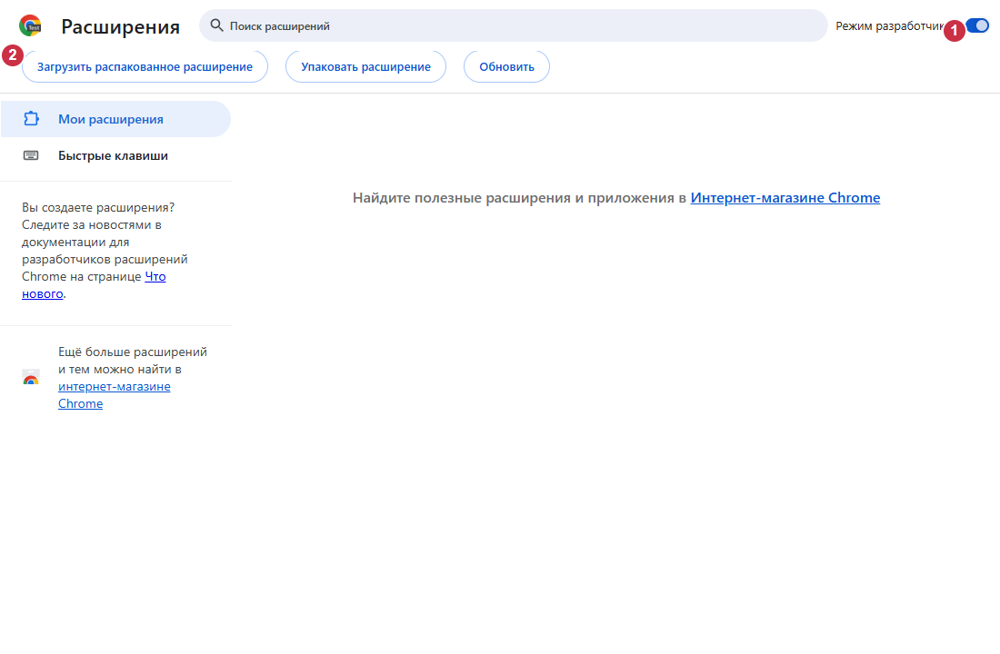

# Установка VidoZavr 1.2.60

[Варианты и языки](README.md) · [Компоненты](COMPONENTS.md)

## Назначение и требования

V1D0Z@VR бесплатно скачивает видео YouTube, Shorts, каналы, плейлисты и трансляции;
есть обрезка и управление очередью. Обработка выполняется локально. Windows-компонент
связывает Chrome с yt-dlp, Deno и FFmpeg через Native Messaging. Одного расширения
недостаточно. Нужны Windows 11 x64, Chrome и интернет при первой установке.
Python, Rust и Node.js пользователю не нужны.

## Скачать и проверить

Используйте [официальные релизы](https://github.com/zatylok/youtube-downloader-chrome/releases).
Выбирайте файлы версии 1.2.60 из одного официального релиза.
Скачайте **VidoZavr.exe** и его `.sha256`. ZIP расширения необязателен.
Сравните SHA-256 с `SHA256SUMS.txt` того же релиза. Например,
`Get-FileHash .\VidoZavr.exe -Algorithm SHA256` только читает файл; для установки
команды и ручная настройка реестра не нужны.

У EXE **нет Windows Authenticode-подписи**. SmartScreen может показать неизвестного
издателя. Проверьте источник и хеш; при сомнении отмените установку. Не отключайте
защиту. Подпись Ed25519 обновлений приложения — отдельный механизм.

## Установить компоненты Windows

Запустите рекомендуемый EXE, нажмите «Далее» и дождитесь «Компоненты Windows
установлены». Setup скачает недостающие закреплённые инструменты и проверит хеши.
Проверенные прежние инструменты используются повторно. Chrome не открывается.
Setup подтверждает файлы и регистрацию, но не живую связь браузера.
На последнем экране указаны точный путь, «Инструкция» и «Папка расширения».
Эти действия выполняются только по вашему нажатию.

## Подключить Chrome вручную

1. В нужном профиле Chrome откройте `chrome://extensions`.
2. Включите **Режим разработчика**.
3. Нажмите **Загрузить распакованное расширение**.
4. Выберите установленную папку `extension`, показанную Setup. По умолчанию:
   `%LOCALAPPDATA%\Programs\YouTube Video & Shorts Downloader\extension`.
   `manifest.json` должен лежать прямо в этой папке.
5. Проверьте одну карточку V1D0Z@VR и ID `bkihgeeibbodemeibfdcglojjkiepnlf`.
6. Откройте меню расширения: должно быть **Загрузчик подключён**.

Оставьте режим разработчика включённым. Решения по разрешениям Chrome принимайте
сами после прочтения запроса. Setup не обходит защиту браузера.

## Дополнительные ZIP и Experimental

EXE уже устанавливает управляемую копию. Не создавайте вторую без необходимости.
Для независимой копии извлеките ZIP в постоянную папку и загрузите её вместо
установленной. Chrome не загружает ZIP напрямую. Windows-компонент всё равно нужен.
Независимую папку Setup не обновляет: заменяйте файлы соответствующим официальным
ZIP и обновляйте прежнюю карточку Chrome. Не загружайте обе копии.

[Beta/Experimental](EXPERIMENTAL.md) сохраняет автоматическое подключение.
Могут понадобиться режим разработчика, решение по разрешениям или ручное восстановление.
Другие расширения и выбор профиля могут помешать. Работа не гарантируется и не является
полностью автоматической; чистая Windows проверена не полностью. Установка общая,
отдельное второе приложение не создаётся.

## Обновить и удалить

Подписанные обновления поддерживают прежнюю папку и ожидают завершения защищённой
работы. Если Chrome показывает старую версию, нажмите «Обновить» на прежней карточке
и обновите вкладки YouTube. Бесшовная активация во всех версиях Chrome не гарантируется.
Не удаляйте карточку ради обычного обновления. Для ремонта запустите Setup снова
после завершения загрузок; защита может попросить временно выключить расширение.
Не удаляйте приостановленные задачи и partial-файлы.
Удаление: Параметры Windows → Приложения → V1D0Z@VR → Удалить, затем карточка
Chrome. Видео, `native\data` и `.updates` сохраняются.

## Ошибки и восстановление

- Нет подключения: проверьте того же пользователя Windows, установленный EXE и
  точную папку; повторите Setup после завершения работы и перезапустите Chrome.
- Нет манифеста: выбрана родительская папка или ZIP, а не распакованная папка.
- Ошибка сети/хеша: повторите официальный источник, не заменяйте ожидаемые хеши.
  Chrome и native-процесс могут использовать разные VPN-маршруты.
- Без сети чистая установка не получает недостающие инструменты. При ремонте могут
  использоваться проверенные прежние файлы; полностью офлайн-работа не обещается.
- `Check.cmd` проверяет файлы и регистрацию; живой статус — меню расширения.

## Иллюстрации

Настоящий изолированный headless Chromium 149, русский интерфейс; номера добавлены
для инструкции: **1** — режим разработчика, **2** — загрузка распакованного расширения.
Пустой тестовый профиль не является записью ручной установки или проверкой чистой Windows.

В настоящем меню расширения получен проверенный ответ native host.
**1** — «Загрузчик подключён». Личные аккаунты и профиль владельца не использовались.

Права и обращения к сети: [README](../../README.md). Лицензии и точные источники:
[аудит компонентов](COMPONENTS.md).
